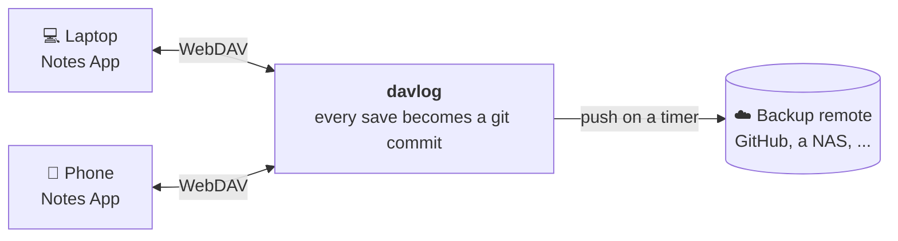

<h1 align="center">davlog</h1>

<p align="center"><strong>A WebDAV server where every save is a git commit.</strong></p>

<p align="center">
  <a href="https://github.com/cbenning/davlog/actions/workflows/ci.yml"></a>
  
  
  
  
  
  
  
</p>

<p align="center">
  <a href="#highlights">Highlights</a> &middot;
  <a href="#quick-start">Quick start</a> &middot;
  <a href="#when-things-go-wrong">When things go wrong</a> &middot;
  <a href="#pushing-to-a-remote-optional">Backups</a> &middot;
  <a href="#security-and-hardening">Security</a> &middot;
  <a href="#known-limits">Known limits</a>
</p>

---

davlog is a WebDAV server that keeps your files in a git repository. Every upload, delete and move becomes a commit, so anything you sync over WebDAV (notes, mostly) gets a history and an undo button, and plain git does the work.



Any notes app that syncs over WebDAV works, for example HelixNotes, or Obsidian with a WebDAV sync plugin. davlog has been tested with rclone and the HelixNotes CLI.

```
$ git log --oneline
3f2a9c1 davlog: update projects/pizza-night.md
b81d0e4 davlog: move drafts/idea.md -> projects/idea.md
9c07e55 davlog: delete scratch/old-list.md
41de6a0 davlog: 3 changes
```

If you give it a remote, it also pushes there on a timer for an off-site copy. When something goes wrong it emails you.

## Highlights

- 📝 **Every save is a commit.** Uploads, deletes, moves and copies each become a commit with a readable message like `davlog: update notes/a.md`. History, diffs and undo are normal git.
- 🧱 **No half-written files.** Uploads go to a temp file and are renamed into place when they finish. A dropped connection leaves nothing behind.
- ⚡ **Fast enough that you won't notice.** A save takes about 4 ms to commit in a 5,000-file repo, and a read about 0.15 ms. Writes that arrive while a commit is running are committed together.
- 🛟 **Safe with your backup remote.** davlog pushes on a timer. It never rebases, merges or force-pushes. If the remote has changes it doesn't know about, it stops pushing and emails you.
- 📬 **Email alerts.** When something goes wrong you get one email with the git commands to fix it, a reminder once a day while it lasts, and a note when it clears. Other channels can be added.
- 🤝 **Steps aside when you use git.** If you start a rebase or merge in its repository, writes get a `503` until you finish. Reads keep working.
- 🧰 **Sets itself up.** There's no `git init` step. On first start it creates the repository, or asks what to do if the right answer isn't obvious.
- 🔌 **Plain WebDAV.** Tested with rclone and a strict notes-sync client, and it passes the litmus suites for basics, copy/move and HTTP. Locking is there for Finder and Explorer.
- 🔒 **Locked down.** `.git` and names that imitate it are hidden, symlinks aren't followed, and there are limits for slow clients, full disks and floods. See [Security and hardening](#security-and-hardening).
- 🧹 **Tidies its own repository.** It packs loose objects in the background and never deletes anything.
- 📦 **Docker first.** Compose files with automatic HTTPS through Caddy. It's also a single binary with a TOML config.

## Why this exists

Notes are just files, and git is a good safety net for files. Most WebDAV servers keep no history, and the usual workaround (a file watcher that commits a folder) commits half-written files and says nothing when a push fails.

WebDAV sync also goes wrong sometimes: two clients disagree, a clock is off, a sync stops halfway. With davlog every accepted state is a commit, so you find the bad sync in `git log` and undo it with `git revert`. The history lives on the server's disk, which is what the optional push is for.

## Quick start

Save this as `docker-compose.yml`:

```yaml
name: davlog

services:
  davlog:
    image: ghcr.io/cbenning/davlog:latest
    restart: unless-stopped
    ports:
      - "127.0.0.1:8080:8080"
    environment:
      DAVLOG_PASSWORD: change-me
      DAVLOG_BOOTSTRAP: init
    volumes:
      - data:/data
    configs:
      - source: davlog.toml
        target: /etc/davlog/davlog.toml

volumes:
  data:

configs:
  davlog.toml:
    content: |
      [server]
      listen = "0.0.0.0:8080"
      repo_path = "/data"
      [auth]
      username = "notes"
```

Then run `docker compose up -d`. davlog is at `http://localhost:8080/`, login `notes` and the password you set. With rclone, for example:

```sh
rclone ls :webdav: --webdav-url=http://localhost:8080 --webdav-user=notes \
  --webdav-pass="$(rclone obscure change-me)" --webdav-vendor=other
```

To see the history:

```sh
docker run --rm -v davlog_data:/data alpine/git -c safe.directory=/data -C /data log --oneline
```

This is plain HTTP on localhost, fine for trying it out. `docker compose down -v` also deletes your files.

### Keep the files in a normal folder

`compose.yaml` in this repo puts the repository in `./data`, owned by you, so you can use git on it directly:

```sh
git clone https://github.com/cbenning/davlog.git && cd davlog
mkdir -p data
printf 'DAVLOG_UID=%s\nDAVLOG_GID=%s\n' "$(id -u)" "$(id -g)" > .env   # so ./data is yours
docker compose up -d
git -C data log --oneline
```

Login is `notes` / `notes`; change it with `DAVLOG_PASSWORD`. Pin a release with `DAVLOG_VERSION=1.0.0-RC8`. Build from your checkout by adding `-f compose.dev.yaml` and `--build`.

### Connect HelixNotes

In the app's WebDAV settings use the same URL, username and password. For the CLI:

```sh
export HELIXNOTES_WEBDAV_URL=http://localhost:8080/
export HELIXNOTES_WEBDAV_USERNAME=notes
export HELIXNOTES_WEBDAV_PASSWORD_FILE=~/.config/helixnotes/password   # a file containing your password
export HELIXNOTES_VAULT=~/notes
helixnotes-cli sync
```

### Run it for real, with HTTPS

This puts davlog behind [Caddy](https://caddyserver.com/), which gets and renews a Let's Encrypt certificate. Run it from a checkout of this repository.

```sh
mkdir -p data secrets
sudo chown 10001 data                          # davlog runs as uid 10001 inside the container
printf '%s' 'a-long-password' > secrets/password
cp config.docker.example.toml davlog.toml      # set the username if you like

DAVLOG_DOMAIN=notes.example.com docker compose -f compose.https.yaml up -d
```

Point a client at `https://notes.example.com/`. To read the history from the host:

```sh
sudo -u '#10001' git -C data log --oneline
```

- Without `DAVLOG_DOMAIN` it serves `https://localhost` with Caddy's local CA. If ports 80 and 443 are taken, set `HTTP_PORT` and `HTTPS_PORT`.
- Only Caddy publishes ports. davlog runs read-only with no extra capabilities, and the `Caddyfile` hides `/healthz` and `/readyz`.
- Don't expose davlog directly: it speaks plain HTTP with Basic auth. Any reverse proxy works; `Caddyfile` is the shortest example.
- For a password hash instead of a file: `printf '%s' 'a-long-password' | docker compose -f compose.https.yaml run --rm -T davlog hash-password`, then set `password_hash` in `davlog.toml`.
- `config.example.toml` documents every setting.

### Without Docker

```sh
cargo build --release
cp config.example.toml davlog.toml        # set repo_path, listen and auth
printf '%s' 'a-long-password' > password  # the file auth.password_file points at
target/release/davlog --config davlog.toml
```

`davlog --help` lists the options. Put a TLS proxy in front of it for anything beyond localhost.

### First start

You don't run `git init`. davlog creates a repository if the data directory has none, and uses an existing one as is. It asks you in three cases:

- the directory has files but isn't a repository
- the remote's branch already has history
- the local and remote histories are unrelated

On a terminal it prompts. In a container it prints the choices and exits with **code 10**; answer with `DAVLOG_BOOTSTRAP=clone|init|abort`:

- `clone`: clone the remote
- `init`: create a repository and keep your files
- `abort`: exit without changing anything

Exit codes: 0 clean, 1 error, 2 bad usage or config, 10 needs a bootstrap answer.

## When things go wrong

| Situation | What davlog does |
|-----------|------------------|
| The remote has commits it doesn't have | Stops pushing, emails the ahead/behind counts and fix commands, keeps serving. Resumes on its own once a push would be a fast-forward. |
| You start a rebase or merge in its repo | Answers writes with `503`, keeps serving reads. Carries on when you finish. |
| A commit fails | Keeps the change on disk, retries every few seconds, emails once. |
| A push fails 3 times in a row | Emails you, with a hint: auth, host key or network. |
| An upload is over `max_file_size` (100 MiB) | Returns `413`. |
| Uncommitted changes at startup | Commits them, unless a rebase or merge is in progress. |
| Wrong branch with `[push]` configured | Refuses to start. |
| A stale `.git/index.lock` (davlog was killed mid-commit) | Removes it once it is 5 minutes old. A newer one is treated as a person's git command, and writes get `503`. |
| A stale `.git/index.lock` (davlog was killed mid-commit) | Removes it once it is 5 minutes old. A fresh one is treated as a person's git command and writes get `503`. |

Alerts go out once, then at most once per `notify.rate_limit` (24 hours) while the problem lasts, with a note when it clears. Email is the only channel so far; another takes one `Notifier` implementation and a config section.

## How commits work

- Default `per_request`: each write is committed as it finishes, and the response waits for the commit.
- Writes that arrive during a commit are committed together.
- `debounce` waits for a quiet period; `interval` commits on a timer.

## Performance

A release build on a 16-core desktop, over loopback, in a 5,000-file repository (about 2 KB each), default `per_request` mode:

| | Median | 99th percentile |
|---|---|---|
| Read a file | 0.14 ms | 0.4 ms |
| Create a file and commit | 3.0 ms | 5.2 ms |
| Overwrite a file and commit | 4.2 ms | 5.9 ms |
| Overwrite and commit, 8 clients at once | 15 ms | 25 ms |

- 8 clients writing at once sustained about 490 commits per second.
- Memory: 14 MB idle, 55 MB with 5,000 files, 85 MB after about 6,400 commits.
- CPU: about zero idle, about one core under sustained writes.

## Pushing to a remote (optional)

Add a `[push]` section and davlog pushes the branch every `interval`. Leave it out and it keeps only the local repository.

**Treat the remote as a write-only backup.** Anything else writing to that branch (another clone, a web edit, a force-push) isn't supported. davlog stops pushing and emails you; you fix it by hand with plain git in the server's repository:

- merge or rebase the remote's changes, or
- if the remote is wrong, `git push --force-with-lease`

With the Docker setup run git as `sudo -u '#10001' git -C data ...`. davlog never branches, merges or rebases for you.

For SSH remotes:

- Set `ssh_key` and a `known_hosts` file. Unknown or changed host keys are refused.
- `known_hosts` must list every host key type the server might offer. For GitHub: `gh api meta --jq '.ssh_keys[]' | sed 's/^/github.com /' > known_hosts`. Hashed `|1|` entries are ignored.
- Use a deploy key limited to the one backup repository: `ssh-keygen -t ed25519 -N "" -f davlog_ssh_key`, then add the `.pub` file with write access.

HTTPS remotes use `token_file`. Secrets can also come from `DAVLOG_PASSWORD`, `DAVLOG_SMTP_PASSWORD`, `DAVLOG_PUSH_TOKEN` and `DAVLOG_PUSH_SSH_PASSPHRASE`, which win over files.

## Other things worth knowing

- **Git settings come from davlog's config.** The host's git config is ignored. Put settings under `[git.config]`, for example `"core.autocrlf" = "false"`.
- **Repacking is automatic.** libgit2 can't run `git gc`, so davlog packs the repository itself. See [Repository upkeep](#repository-upkeep).
- **`GET /healthz`** says the process is alive, with last commit and push times and state flags. The Docker image uses it.
- **`GET /readyz`** returns 200, or 503 with a list of problems (pushing paused, rebase in progress, disk full, commits or pushes failing). Point an uptime monitor at it.
- Neither endpoint needs a login or shows file names.
- Locking (in memory) is there for macOS Finder and Windows Explorer.
- Git LFS isn't supported.

## Security and hardening

### What davlog does for you

- **Passwords** are compared in constant time, and `auth.password_hash` takes an argon2id hash. Failed logins are logged with the client address, never what was typed.
- **`.git` is hidden**, along with names that act as `.git` elsewhere (`.GIT`, `GIT~1`, `.git::$INDEX_ALLOCATION`). Symlinks are never followed.
- **No destructive git operations.** Nothing rewrites history, force-pushes or prunes, so stolen credentials can delete current files but not what's committed.
- **Limits** on file size, free disk, repository size (`507`), connections, slow headers and stalled uploads. `Depth: infinity` is refused. See `config.example.toml`.
- **Stored files can't take over the origin.** Responses carry `nosniff`, and HTML, SVG and XML are served with `Content-Security-Policy: sandbox`.
- **Secrets stay out of logs** and the health endpoints.

### What to do yourself

- **Use HTTPS.** `compose.https.yaml` is a working setup.
- **Keep it off the open internet** if you can. Tailscale, WireGuard or an IP allowlist removes most of the risk.
- **Use a long random password**, or an argon2 hash.
- **Rate-limit logins at your proxy.** Each failure logs `failed login peer=<address>` for fail2ban. Behind a proxy that address is the proxy's. `auth.failed_login_delay` is an off-by-default extra; it holds connections open while it waits.
- **Prefer secret files to environment variables**, since `docker inspect` shows the environment. Make config files with secrets `chmod 600`.
- **Give the push credential minimal access:** a deploy key or fine-grained token for the one backup repository.
- **Keep the container locked down.** The compose file already uses a non-root user, read-only filesystem, no capabilities and `no-new-privileges`. Consider `mem_limit` and `pids_limit` (examples in `compose.https.yaml`).
- **Watch the disk.** History only grows. The `507` limits stop a full disk and send an alert.
- **Back up the volume, not just the remote.**
- **Keep it updated.** Rebuild the image now and then. The repo uses Dependabot, pinned base images and a weekly `cargo audit`, which currently shows one "unsound" warning on the `lru` crate via `dav-server`, with no fix yet.
- **Be careful cloning the repository elsewhere.** Anyone with the WebDAV password wrote its contents, so don't run scripts or hooks from it unread.

### Repository upkeep

libgit2 can't run `git gc`, so davlog repacks (`[maintenance]`, on by default). Every 6 hours it checks, and does one of two things:

- **More than 2,000 loose objects:** it packs just those into a new pack, which is quick and needs little memory.
- **More than 20 packs:** it rewrites everything into one pack (and finds deltas, so it also saves space). This needs memory in proportion to the repository.

Either way it:

1. writes the new pack
2. reads every object back from that pack to check it
3. only then deletes the loose objects (and, when consolidating, the old packs) it replaces

It runs in a separate process. If the system kills it for using too much memory, the server carries on, you get a "maintenance failed" email, and nothing was deleted. Give the container more memory, or consolidate less often, if you see that.

It never prunes, leaves packs with a `.keep` file alone, and deletes nothing if a step fails. `git fsck --full` is clean afterwards and plain `git gc` still works.

It doesn't shrink history. A deleted file, or a secret that was ever uploaded, stays in the repository. To remove one, stop davlog, run `git filter-repo`, and start it again.

## Known limits

- **No dead properties.** `PROPPATCH` returns 501, so client-set modification times are ignored.
- **Case and Unicode.** The filesystem is case-sensitive and Unicode isn't normalised.
- **`LOCK` on a missing path** creates the lock but no file until the client uploads.
- **Empty directories** exist on disk but aren't in git history.
- **Deleting a folder** can produce several commits.
- **`/healthz` and `/readyz` are reserved** names at the top of the repository.
- **A client-written `.gitignore`** can stop files being versioned; davlog only logs a warning.
- **Don't edit the data directory by hand while davlog runs.** A file rewritten in place while it's read can crash the process. Stop davlog first.
- **One writer per repository.** No clustering or failover.
- **SSH push** has been run against GitHub (deploy key) and a NAS. Other servers should work but are untried.

## Testing

- `cargo test` runs unit and integration tests, including a local bare repository standing in for the remote.
- `scripts/smoke.sh` syncs a tree up and down with rclone and checks the commits. It also runs litmus and cadaver if installed.
- **litmus 0.13:** `basic` 16/16, `copymove` 13/13, `http` 4/4, `locks` 38/41, `props` 11/14. Every failure is a `PROPPATCH` answered with 501.
- **HelixNotes' CLI** (strict about ETags): two vaults synced with edits and deletes both ways. It caught PROPFIND returning `getetag` without quotes, which davlog now fixes. Nothing in davlog depends on HelixNotes.

## Built with

Rust, `tokio` and `hyper`, the [`dav-server`](https://crates.io/crates/dav-server) crate for WebDAV, and [`git2`](https://crates.io/crates/git2) (libgit2) for all git work. davlog never runs the `git` binary.

## License

[MIT](LICENSE)
